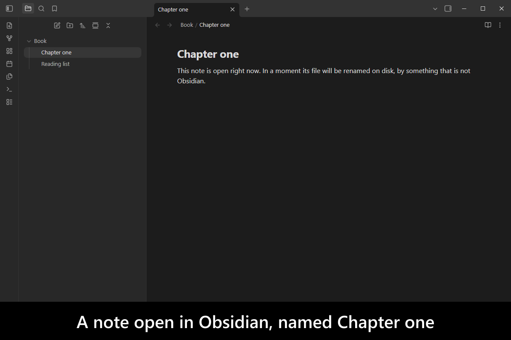
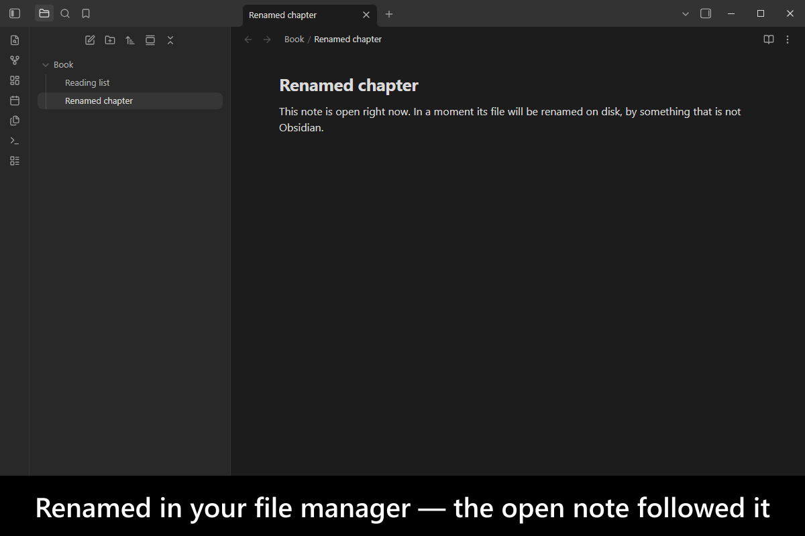

# External Rename Handler

   

Rename a note inside [Obsidian](https://obsidian.md/) and every link to it is updated. Rename the same file in your file manager, from a script, or through a sync client, and Obsidian sees a delete followed by a create — so the links are not updated, and every note that pointed at it is left pointing at nothing.

This plugin recognizes those external renames for what they are and reports them to Obsidian as a single rename, so the file keeps its identity instead of arriving as a stranger. Rewriting the links that pointed at the old name is then done by [Advanced Rename and Delete Handler](https://github.com/mnaoumov/obsidian-advanced-rename-and-delete-handler) — see [Renames](#renames) below.

> [!WARNING]
>
> A rename made while Obsidian is closed is recognized at the next start only when the file kept its identity on disk (the same inode and creation time).
>
> Not every file system keeps that identity: see [Supported file systems](#supported-file-systems).
>
> The plugin only handles renames for those files/folders that Obsidian tracks.
>
> The plugin only handles renames made inside the vault.
>
> The plugin doesn't handle the renames made outside of the vault even if the renamed files are referenced within the vault.
>
> The plugin doesn't handle the renames in files/folders that start with `.` (dot).

<!-- markdownlint-disable MD033 -->

More screenshots

<!-- markdownlint-enable MD033 -->

## Demo vault

**The documentation is a demo vault.** Every feature has a note that explains what it does and why you would want it, with a note ready to rename and backlinks ready to watch.

**[Start reading here](<./demo-vault/00 Start.md>)** — it is plain markdown, so it works on GitHub with nothing installed.

A copy of the vault ships with every release. You can access it via any of the following:

1. Running the **`External Rename Handler`: Open demo vault** command.
2. Downloading `external-rename-handler-demo-vault.zip` from the [Releases](https://github.com/mnaoumov/obsidian-external-rename-handler/releases). It unzips into a single `external-rename-handler-demo-vault-<version>` folder.
3. Browsing its source in [`demo-vault/`](./demo-vault/README.md) in this repository.

## What it does

- **A rename made outside Obsidian is recognized as a rename**, instead of arriving as an unrelated delete and create. [01 External renames](<./demo-vault/01 External renames.md>)
- **A rename made while Obsidian was closed** is recognized when Obsidian starts again. [03 How it works](<./demo-vault/03 How it works.md#renames-made-while-obsidian-was-closed>)
- **Moving a file, and moving whole folders**, are handled the same way. [02 Moving and folders](<./demo-vault/02 Moving and folders.md>)
- **How the detection works**, and therefore where its limits are — worth reading before trusting it with anything irreversible. [03 How it works](<./demo-vault/03 How it works.md>)
- **Which file systems it works on**, each one measured. [03 How it works](<./demo-vault/03 How it works.md#file-systems>)
- **Every setting**, by the key it is stored under. [04 Settings](<./demo-vault/04 Settings.md>)

## Renames

Up to version 3 this plugin rewrote the links itself, through a copy of a rename/delete handler that four other plugins also bundled — so which copy actually ran depended on Obsidian's load order. Since **4.0.0** it does not, and rename and delete handling belongs to [Advanced Rename and Delete Handler](https://github.com/mnaoumov/obsidian-advanced-rename-and-delete-handler) instead — one plugin owning it for the whole vault.

The two are meant to be used together: this plugin sees the rename your file manager made, that one updates the notes pointing at the old name. This plugin offers to install it, once, and carries your old `Should update links` value over for you to approve. Decline, and external renames are still detected — the file keeps its identity, its open tab and the file explorer follow it — but the links are left as they were.

## Supported file systems

The plugin knows a rename by the file keeping its inode, the number the file system identifies a file by, across the delete and the create Obsidian would otherwise see. So it works where a rename keeps that number, and only there.

Every row below was measured with the plugin's own watcher settings (`chokidar` 6.0.0, Node 26 on Windows 11, Node 22 on Linux under WSL 2): a rename, a move to a subfolder and a folder rename, with both the default polling watcher and the native one (`pollingIntervalInMilliseconds` set to `0`).

| File system | Where | Live renames | Renames while Obsidian was closed |
| --- | --- | --- | --- |
| NTFS | Windows, local disk | Yes | Yes |
| NTFS under OneDrive (Files On-Demand) | Windows | Yes | Not measured |
| Google Drive for desktop (its `G:` drive) | Windows | Yes | Not measured |
| SMB share of a Windows NTFS disk | Windows | Yes (measured with polling only) | Not measured |
| SMB share of a Synology NAS | Windows | Files yes; folders only with a longer timeout, see below; nothing at all without polling | Not measured |
| ext4 opened through `\\wsl.localhost` | Windows | Yes with polling; nothing at all without it; may report a false rename, see below | Not measured |
| ext4 | Linux | Yes; may report a false rename, see below | Yes: the inode survives a remount |
| FAT32 (`vfat`) | Linux | Yes | **No**: every mount renumbers the inodes |

Not tested at all: FAT32 and exFAT on Windows (USB sticks, SD cards), exFAT on Linux, ReFS, APFS and HFS+ on macOS, NFS, Btrfs, Dropbox and iCloud Drive.

What goes wrong where it does not work:

- **A rename is missed**, and you are told nothing. Obsidian sees a delete and a create, exactly as it would without the plugin, and the links to the old name are left unresolved. That is what happens to a folder renamed on the Synology share with the default `deletionRenameDetectionTimeoutInMilliseconds` of `500` (5 times out of 6), to every rename on a share without polling (the native watcher reported no change at all there), and to a rename on a Linux FAT32 drive made while Obsidian was closed. On a network share, raise the timeout to `3000` (3 times out of 3) and keep polling on.
- **A rename is reported that never happened.** ext4 gives a freed inode to the next new file straight away, so a deleted note and an unrelated note created after it can share an inode. The plugin tells them apart by the creation time saved with the inode, both while Obsidian is running and at startup, but that time is kept to the millisecond. A note created in the same millisecond the other was deleted, which a script deleting and creating files in a tight loop manages most of the time (41 to 45 times out of 50 when measured), is still reported as a rename of the first into the second, and with `Advanced Rename and Delete Handler` installed the links to the deleted note are rewritten to the new one. A person deleting one note and creating another by hand is far slower than that.

On every file system measured, a save that writes a new copy and swaps it in for the note gives the note a new inode. While Obsidian is running, the plugin sees that save as an edit and records the new inode, so a later rename is still recognized. A later rename, but not one made straight after the save: the polling watcher looks at the disk once per `pollingIntervalInMilliseconds` (`2000` by default), and a rename made before it has looked at the new copy reaches the plugin as nothing but a new name with an unknown inode and an old name that is gone. That is exactly what deleting one note and creating an unrelated one looks like, so the plugin reports a delete and a create. Measured on a local NTFS disk with the default interval, a rename 0 or 250 ms after the save was missed 10 times out of 10, 500 ms after 9 times out of 10, 1 or 1.5 seconds after 2 times out of 10, and 1.9 seconds or more after never. The native watcher (`pollingIntervalInMilliseconds` set to `0`, local disks only, see above) caught every rename made 250 ms after the save, but missed 4 out of 5 made straight after it, as a script would. Most ways of writing a file on Windows rewrite it in place and keep its inode — PowerShell's `Set-Content` and `Out-File`, .NET's `File.WriteAllText` and Node's `fs.writeFile` all did — while `git checkout` of a changed note gave it a new one. A save like that made while Obsidian was closed is caught at the next start: the plugin saves each note's modification time and size with its inode, and looks at the note on disk again when either has changed. A tool that swaps in a copy with the same size and keeps the old modification time, as a sync tool can, still goes unseen, and the next rename of that note made outside Obsidian is missed until the note is changed again with Obsidian open.

## Similar plugins

- [`Link Keeper`](https://github.com/RyotaUshio/obsidian-link-keeper) — not in the community directory; pairs a create with a delete that arrives within half a second, when the two share a name or a folder, and updates the links itself. It needs no inode, so it also runs on mobile, and it calls itself experimental; this plugin matches renames by inode, also catches renames made while Obsidian was closed, and leaves the links to `Advanced Rename and Delete Handler`.
- [`Vault File Refresh`](https://community.obsidian.md/plugins/vault-file-refresh) — polls the whole vault so that files added or changed from outside reach Obsidian where its own watcher misses them, as under Flatpak or on a network drive; it does not recognize renames, which this plugin does.
- [`Auto Refresh Explorer`](https://community.obsidian.md/plugins/auto-refresh-explorer) — polls a few chosen folders for new files that a sync tool wrote and adds them to Obsidian; it does not recognize renames either.

Last searched for similar plugins on 2026-10-26.

## Installation

The plugin is available in [the official Community Plugins repository](https://community.obsidian.md/plugins/external-rename-handler).

### Beta versions

To install the latest beta release of this plugin (regardless if it is available in [the official Community Plugins repository](https://community.obsidian.md) or not), follow these steps:

1. Ensure you have the [BRAT plugin](https://community.obsidian.md/plugins/obsidian42-brat) installed and enabled.
2. Click [Install via BRAT](https://intradeus.github.io/http-protocol-redirector?r=obsidian://brat?plugin=https://github.com/mnaoumov/obsidian-external-rename-handler).
3. An Obsidian pop-up window should appear. In the window, click the `Add plugin` button once and wait a few seconds for the plugin to install.

## Debugging

By default, debug messages for this plugin (id: `external-rename-handler`) are hidden.

If you need to enable them refer to the [documentation](https://mnaoumov.dev/obsidian-lib/guides/debugging/).

## Changelog

All notable changes to this project will be documented in the [CHANGELOG](./CHANGELOG.md).

## Contributing

Contributions are welcome — see [CONTRIBUTING](./CONTRIBUTING.md) to get set up.

## Support

<!-- markdownlint-disable MD033 -->

<!-- markdownlint-enable MD033 -->

## My other Obsidian resources

[See my other Obsidian resources](https://github.com/mnaoumov/obsidian-resources).

## License

© [Michael Naumov](https://github.com/mnaoumov/)
